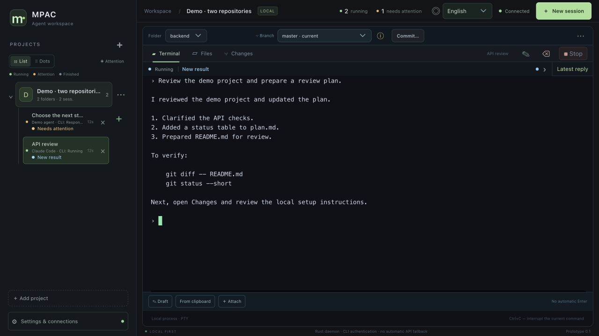
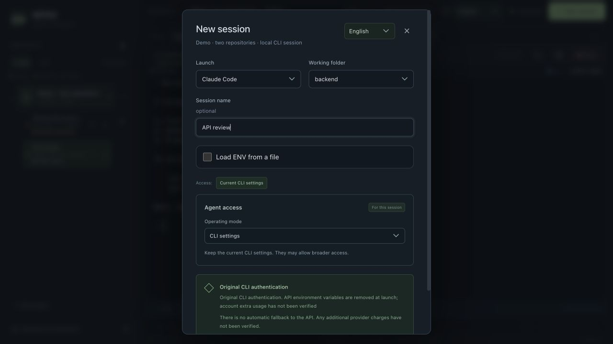
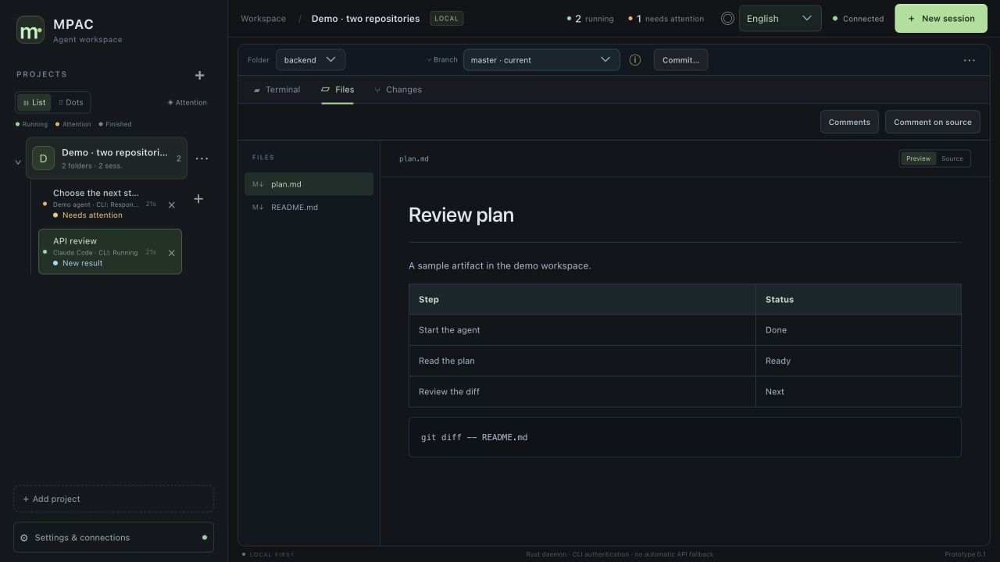
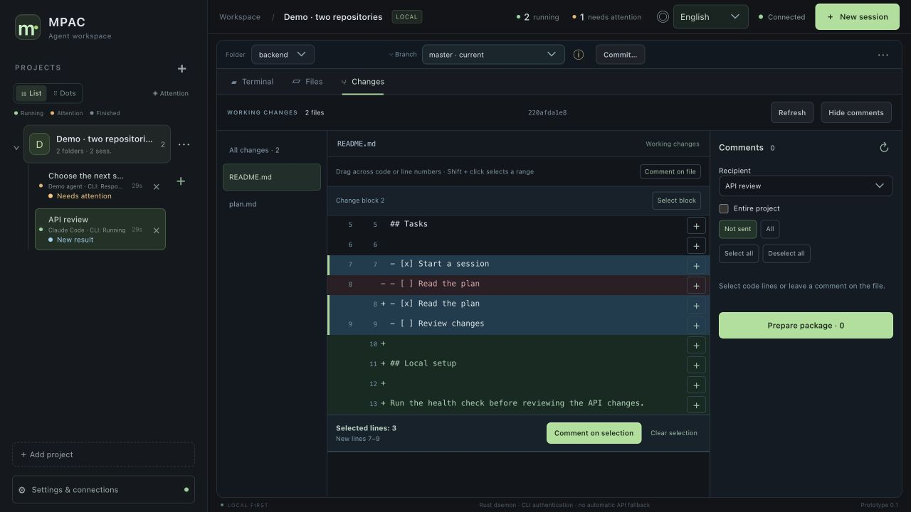
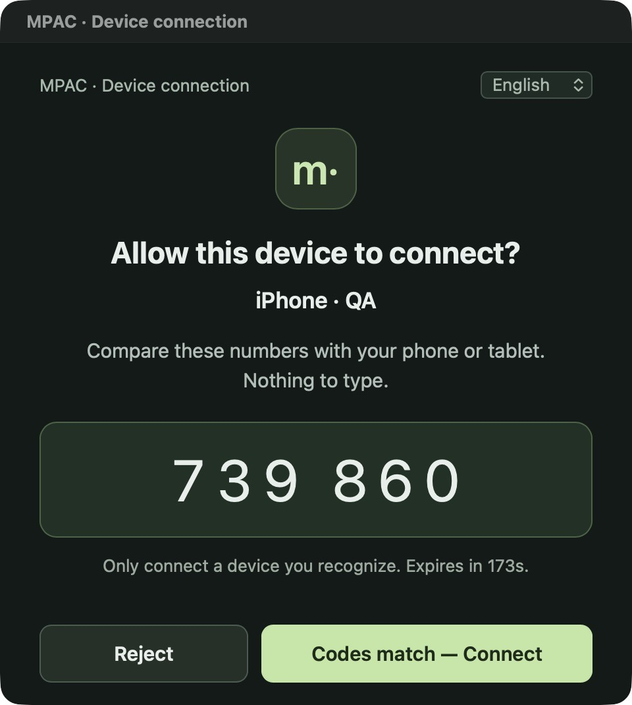
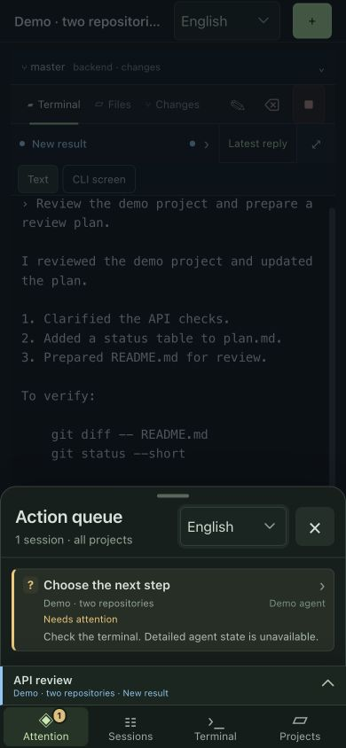
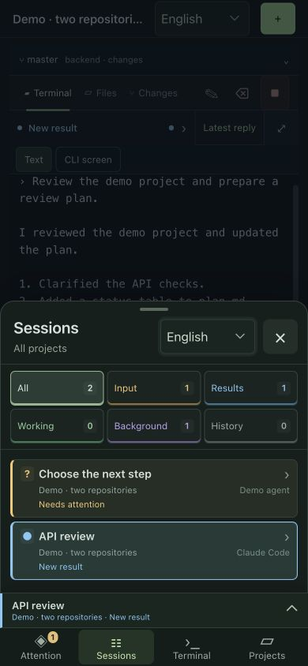
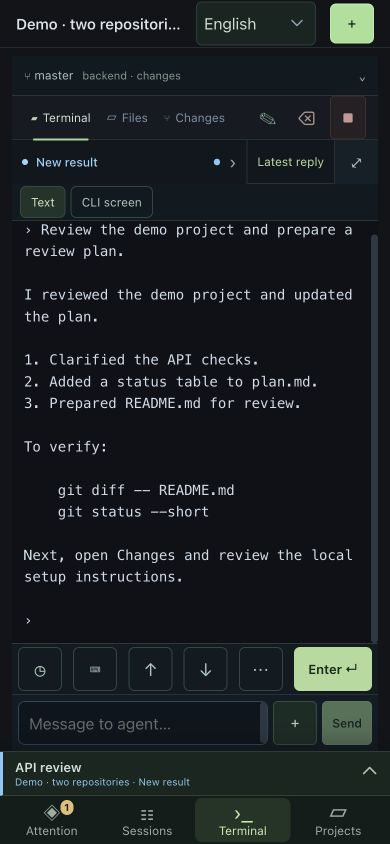
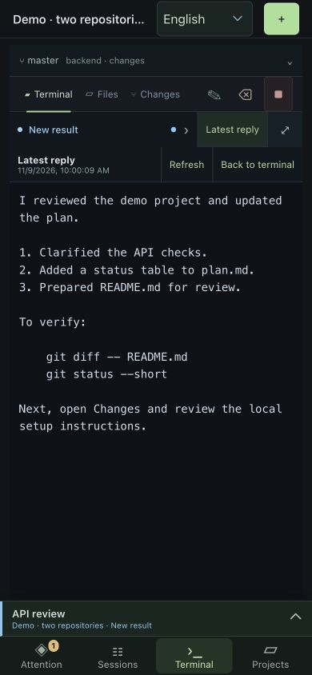

# MPAC User Guide

MPAC brings agent terminals, project files, and Git changes into one workspace. Start an agent on your computer, check its reply on your phone, send a follow-up, and return to the Mac to review the changes.

Agents run on the **computer hosting MPAC**. That computer holds the repositories and runs Claude Code, Codex, Hermes, and shell processes. The mobile app connects to the same workspace over the network.

- [Install and get started](#install-and-get-started)
- [Projects, agents, and terminals](#projects-agents-and-terminals)
- [Agent activity and replies](#agent-activity-and-replies)
- [Files and Git review](#files-and-git-review)
- [Connect an iPhone, iPad, or Android device](#connect-an-iphone-ipad-or-android-device)
- [Work from a phone or tablet](#work-from-a-phone-or-tablet)
- [Troubleshooting](#troubleshooting)

The screenshots use a demo workspace. Phone screenshots show the shared MPAC interface at phone width. The device approval screenshot comes from a Mac test build.

## Install and get started

### Run on your computer

Install Git, Node.js 22 or later, and the Rust toolchain pinned in [rust-toolchain.toml](../rust-toolchain.toml). Clone the repository and start the local server:

```sh
git clone https://github.com/tereshed/mpac.git
cd mpac
./scripts/start-local.sh
```

Open the URL printed by the server. The initial URL contains your workspace token. Keep it private and use the separate pairing flow to connect a phone. Closing a browser tab leaves the sessions running. Stopping the server ends the processes it started.

For a native Mac window, build and open the app:

```sh
./scripts/build-desktop.sh
open target/release/bundle/macos/MPAC.app
```

The build requires Xcode tools and the [Tauri prerequisites for macOS](https://v2.tauri.app/start/prerequisites/). On first launch, choose a workspace folder. If MPAC is already running from this checkout, select its `.mpac` data folder to use the same projects. Choose a different folder to start a separate workspace.

While the desktop app is running, it prevents macOS from going to sleep due to inactivity. Closing the window hides the app and keeps this protection active. **⌘Q** quits the app and releases the sleep assertion. The display can still turn off.

### Your first five minutes

1. Select the sample project with two repositories. It contains `backend` and `frontend`.
2. Click **New session**, choose **Demo agent** and the `backend` folder, then launch the session.
3. Type `status` and press **Enter**. The demo runs locally without a model account or API key.
4. Open `plan.md` in **Files** and `README.md` in **Changes**.
5. Switch the project folder to `frontend` to see how one project can contain two independent repositories. Type `exit` in the demo terminal to end the session.



## Projects, agents, and terminals

### Add a project and start a task

1. Click **Add project** and give it a name.
2. Add one or more existing folders. They can be repositories, related services, or Git worktrees. MPAC references each folder in place.
3. Open **New session**, choose a launch type and set the **Working folder**. The CLI starts in that folder.
4. Name the session after the task, such as “API review.” You can rename it later.
5. Review **Agent access**. Additional folders and broader permissions are selected at launch. A working folder sets the starting directory. Actual access also depends on the CLI's permission mode and the host user's OS permissions.



| Launch type | When to use it |
| --- | --- |
| Demo agent | Try the workspace, terminal, and phone connection without a model. |
| Claude Code, Codex CLI, Hermes | Use a CLI already installed and authenticated on the host. If it is unavailable, check the host's installation and PATH. |
| Z.ai through Claude Code | Choose Claude Code and load an environment file prepared for Z.ai. The separate Z.ai entry is currently unavailable. |
| Terminal without an agent | Open an interactive shell in the project folder. |
| Custom command | Run a command through the shell and view its output in MPAC. |

Use **Settings & connections → Launch settings** to set defaults for an agent or project. Review or override those defaults in the new session form. To provide custom environment variables, select **Load ENV from a file**. The new CLI process receives the values. See [Session environment files](session-environment.md).

MPAC uses the installed CLI's authorization and settings. Billing depends on the account and provider profile selected in that CLI. If you need to stay within a subscription, check its usage and billing settings before starting.

Use the **⋯** menu next to a project to edit its name or folders, or remove it from the list. Restore removed projects from **Settings & connections**. Stop active sessions in a project before removing it.

### Enter text, attach files, and dictate

- Type short requests in the terminal. **Enter** sends the Enter key to the CLI. **Shift+Enter** inserts a new line in supported agents.
- Open **Draft** for a longer task. **Paste into terminal** places the text on the CLI input line so you can check it before pressing Enter.
- Use **Attach** for a file or image, or paste supported clipboard content. MPAC copies attachments into `.mpac-attachments` under the session's working folder and inserts their paths. Check whether the CLI supports the file type and review the file list before committing.
- In native clients, open **Voice input** in settings. Choose OpenAI, OpenRouter, Groq, or a compatible provider and enter your own API key. Record a message, press **Recognize**, and review the result in the draft. Audio goes to the selected provider when you request transcription. Configure the provider and key on each device where you use it.

Sessions are grouped by project. **List** shows session names and states, while **Dots** gives you a compact view. **Stop** ends the CLI process. Removing a session record is a separate, confirmed action. You can restore that record from **Removed sessions**. Sessions stopped by a server restart must be started again.

## Agent activity and replies

| What you see | What to do |
| --- | --- |
| **Needs input** or **Waiting for permission** | Open the terminal and respond to the question or review the requested action. |
| **New result** | Read the terminal output or open **Latest reply**. Ordinary replies appear in **Results**. |
| **Agent is working** | Check the terminal and the current tool, when the CLI reports one. |
| **Background work** | Open activity details for the tasks, schedules, and timestamps the agent reported. |
| **Agent state unknown** | Check the terminal. The CLI may be running even when activity events are unavailable. |

Click the status row above the terminal for more detail. Tool calls show what MPAC observed. Background tasks are a snapshot of what the agent reported at that time.

**Latest reply** is available for Claude Code and Codex when the CLI provides a reply through a supported hook. MPAC stores the latest received message separately from terminal scrollback, so you can open it again after reconnecting. **Refresh** checks for a newer saved reply. Use the terminal and history for earlier context. Replies from sessions that did not report them may be missing.

## Files and Git review

### Read documents and source files

1. Choose a **Folder** in the project toolbar and open **Files**.
2. Choose a document from the file tree. For Markdown, **Preview** displays tables, lists, and code blocks. **Source** shows the underlying text.
3. Select source lines to leave a review comment. On desktop, use **⌘+click** or **Ctrl+click** on a recognized project path such as `docs/guide.md:42` in terminal output to open it in the file viewer.



### Inspect a diff and send review notes

1. Open **Changes**. Select a file or **All changes**. Staged and working changes are shown separately.
2. Use **+** beside a line to comment on it. Use **Shift+click** on line numbers to select a range, or select a whole change block. You can also comment on the file.
3. In **Comments**, choose an existing session or create a new one. Select **Entire project** for notes across folders. The receiving session needs access to those folders.
4. Select the comments and choose **Prepare package**. Add a shared task if needed, such as “Clarify how to verify the API and update the setup guide.”
5. Review the preview and paste the batch into the terminal. Check the draft and press **Enter** to submit it. If the underlying code changes, revalidate the affected comment before preparing or inserting the batch.



The current Git branch appears next to the folder. You can switch to an existing local branch when the working tree is clean and no running session is using the affected repository. **Commit…** lets you select whole files, review the snapshot, and make a local commit. Use Git in the terminal to create branches, push, fetch, stash, or stage part of a file.

## Connect an iPhone, iPad, or Android device

### Install the mobile app

The public repository provides source and build scripts. Installation depends on your platform.

- **iPhone and iPad.** If you received a tester invitation, open it in TestFlight and install MPAC Mobile. To build for your own physical device, use Xcode and your Apple Developer signing configuration. [Apple's TestFlight instructions](https://testflight.apple.com/).
- **Android.** Install an APK you built yourself or obtained from a trusted build provider. The local build script produces an arm64 debug APK. Android asks for permissions such as microphone access when you use the relevant feature.
- **Build from source.** Initialize the platform using the [mobile development instructions](../README.md#mobile-development). Run `sh scripts/build-mobile.sh ios` for the Apple Silicon iOS Simulator or `sh scripts/build-mobile.sh android` for Android. Use `./scripts/build-testflight.sh BUILD_NUMBER` with your own signing configuration for an iOS distribution build.

A TestFlight invitation installs the app. An MPAC pairing invitation connects the installed app to a workspace.

### Pair for the first time over Wi-Fi

1. Start **MPAC on the Mac**. Connect the Mac and your phone or tablet to the same local network.
2. On the Mac, open **Settings & connections → Phone & Telegram**.
3. Select the address marked **LAN** and click **Open connection**.
4. In the connection window, click **Create pairing link & QR**. Scan the QR code with the phone's camera or paste the invitation into MPAC Mobile. Pairing invitations expire after three minutes.
5. On the phone, tap **Review connection**, check the computer address, and tap **Connect**.
6. Compare the six digits on both devices. On the Mac, choose **Codes match — Connect** for the device you recognize.
7. Open the sample project on the phone and try `status` in a demo session. The app remembers the approved connection. To remove a device later, choose **Revoke access** next to it on the Mac.



*The code shown is from a completed demo pairing.*

If a browser opens the invitation page, use **Open in MPAC** or copy the full invitation and paste it into the app's pairing field. Pairing grants access to workspace files and terminals. Share invitations only with a device or person you trust.

### Connect away from home and send links with Telegram

To connect over cellular data, join the Mac and the phone to the same private Tailscale network. Choose the Mac's **Tailscale** address in **Phone & Telegram**, open the connection, and pair again using a fresh invitation for that address. Try opening a demo session with Wi-Fi turned off on the phone. [Tailscale quickstart](https://tailscale.com/docs/how-to/quickstart).

**Keep mobile access active after quitting MPAC** runs the mobile gateway as a background service on macOS. The Mac still needs to be awake and reachable. To retain MPAC's idle sleep protection, leave the desktop app running. You can close its window.

Telegram can deliver a pairing invitation. In **Phone & Telegram**, enter a token from BotFather for a dedicated bot. Open the bot's private chat and press **Start**, then select **Check my chat** and **Confirm this private chat**. Use **Send link to Telegram** to send the invitation. The phone still needs a network path to the Mac, and the Mac must approve a new device.

## Work from a phone or tablet

The phone layout has four tabs along the bottom:

- **Attention** lists questions, permission requests, and errors that may need intervention.
- **Sessions** shows all tasks and filters for **Input**, **Results**, **Working**, **Background**, and **History**.
- **Terminal** opens the active session. Use the session bar above the navigation to switch quickly.
- **Projects** opens the project list for the current workspace.




### Reply to an agent

1. Open a session from **Attention** or **Sessions**.
2. For a CLI menu or dialog, use **↑**, **↓**, and **Enter ↵**. Open **⋯** for more keys, including **Tab** and **Esc**.
3. For a text response, use **Message to agent**. **⌨** opens the keyboard. **+** next to the message field expands the draft and attachment controls.
4. Tap **Send** to submit the prepared message. Use **Enter ↵** for a line already typed in the CLI or to confirm a menu selection. If MPAC cannot confirm delivery, inspect the terminal before retrying.



### Read replies and review changes

**Text** wraps the available terminal output to the width of the phone. **CLI screen** shows the terminal's original layout for interactive menus. **◷ History** opens a snapshot of available output. **Latest reply** opens the newest saved agent message in a separate, scrollable view.



**Files** and **Changes** work with the same folders as desktop MPAC. In a wide iPad window, keep projects and sessions in the sidebar while reading a file or using the terminal. Narrow windows use the compact navigation. A typical phone workflow is to check **Attention**, read the result, inspect a diff, and send a follow-up. Use a larger screen for a review spanning several files.

## Troubleshooting

| Symptom | What to check |
| --- | --- |
| An agent is unavailable in the launch form | Check that its CLI is installed, authenticated, and on the MPAC host's PATH. |
| MPAC stays on the opening screen on the Mac | Check for a macOS permission prompt for the workspace folder. **Workspace → Reconnect** retries the connection. |
| The phone cannot reach the computer | Check that the Mac is awake, the gateway is running, and you selected the correct address. Devices must be reachable through the same LAN or private Tailscale network. |
| An invitation opens in a browser | Use **Open in MPAC** or paste the complete invitation into the mobile app. Create a fresh one if it has expired. |
| A saved connection stops working after a network change | Pair again with an invitation for the new address. The saved connection uses the old address and certificate. |
| The terminal shows only part of the output | Try **Text**, **History**, and **Latest reply**. Terminal scrollback has a retention limit. |
| A Git branch cannot be selected | Check for modified or untracked files and active sessions in the repository. Save the changes and stop the affected sessions before switching. |
| Voice input fails | Check microphone permission, the API key and model, and whether the device can reach the provider. |

See [Terminal streaming](terminal-streaming.md) for more on output, reconnects, and retained replies.
