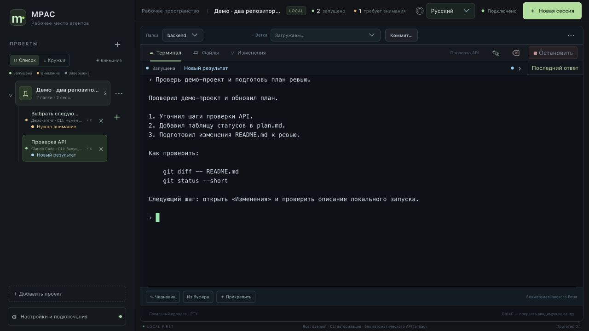
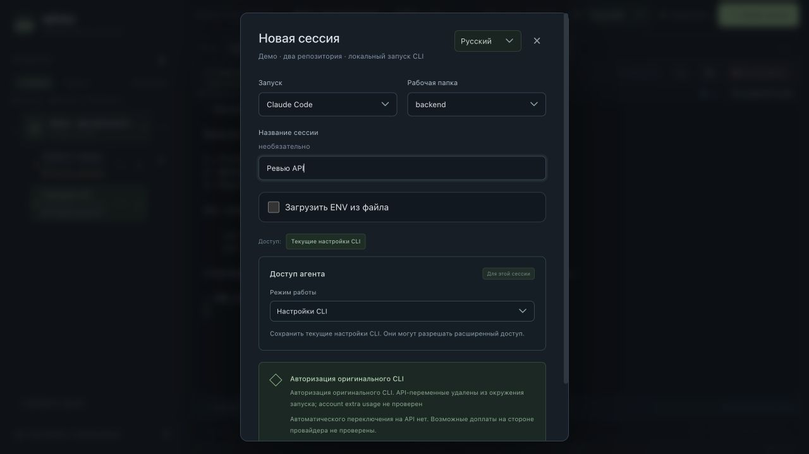
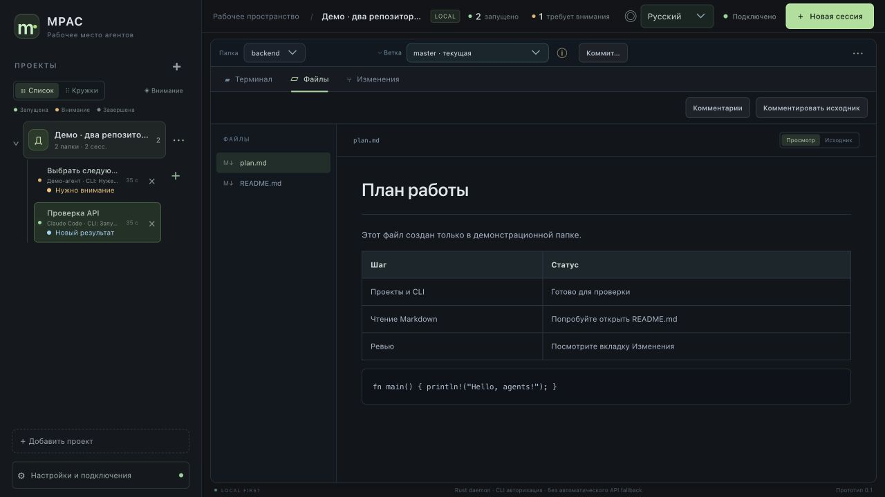
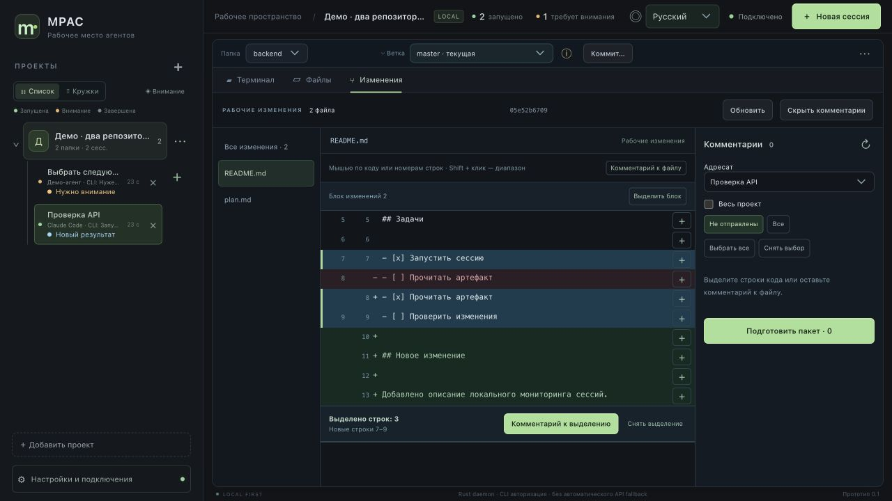
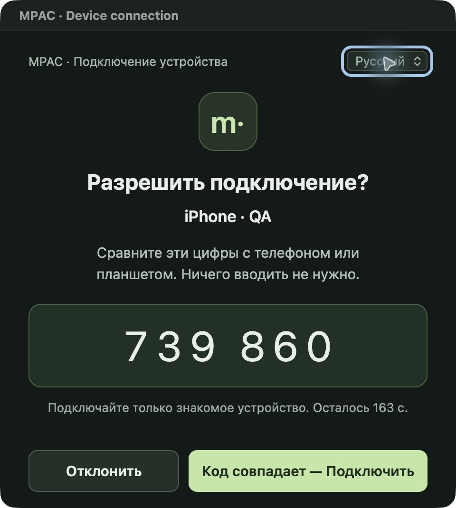
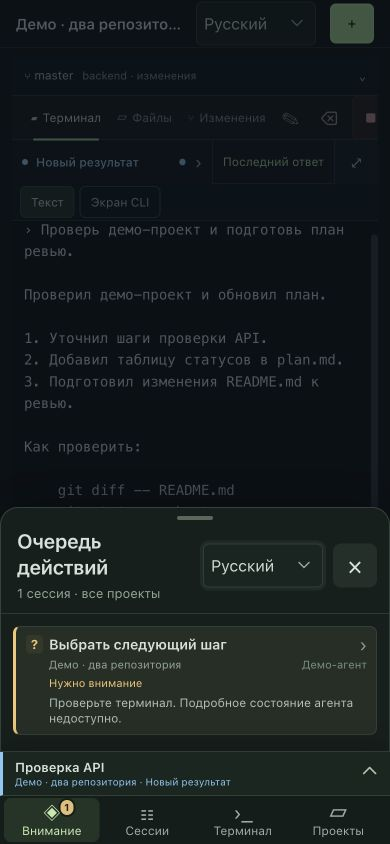
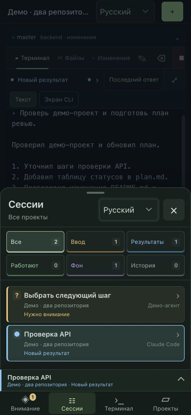
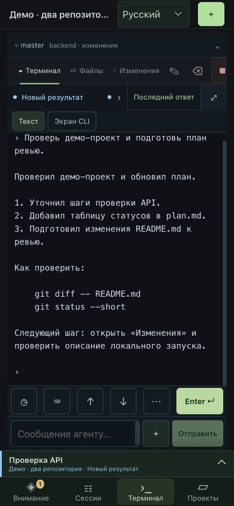
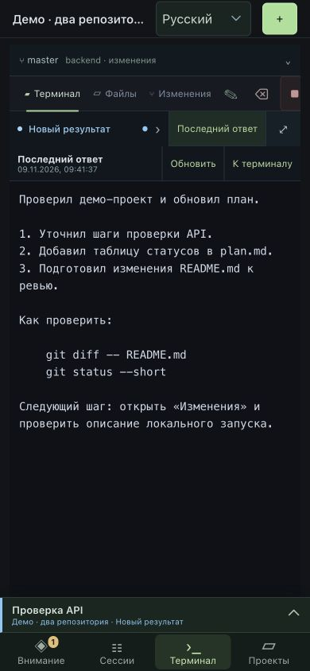

# Руководство по MPAC

MPAC собирает терминалы с агентами, файлы и Git-изменения нескольких проектов в одном рабочем пространстве. Можно запустить задачу на компьютере, посмотреть ответ на телефоне, дать агенту уточнение и вернуться к ревью на Mac.

Агенты выполняются на **компьютере, где запущен сервер MPAC**. Там находятся репозитории, рабочие папки и процессы Claude Code, Codex или Hermes. Мобильное приложение подключается к этому пространству по сети. Интерфейс поддерживает русский, английский и испанский. Язык выбирается в верхней части окна или в мобильной панели.

- [Установка и быстрый старт](#установка-и-быстрый-старт)
- [Проекты, агенты и терминал](#проекты-агенты-и-терминал)
- [Статусы и ответы агентов](#статусы-и-ответы-агентов)
- [Файлы и Git-ревью](#файлы-и-git-ревью)
- [Подключение iPhone, iPad и Android](#подключение-iphone-ipad-и-android)
- [Работа с телефона и планшета](#работа-с-телефона-и-планшета)
- [Если что-то не работает](#если-что-то-не-работает)

На иллюстрациях используется отдельный демо-проект. Мобильные экраны сняты в общем интерфейсе MPAC на ширине телефона. Окно подтверждения снято в тестовой сборке для Mac.

## Установка и быстрый старт

### Запуск на компьютере

Установите Git, Node.js 22 или новее и Rust. Версия Rust закреплена в [rust-toolchain.toml](../rust-toolchain.toml). Склонируйте репозиторий и запустите локальный сервер:

```sh
git clone https://github.com/tereshed/mpac.git
cd mpac
./scripts/start-local.sh
```

Откройте адрес, который выведет сервер. В первом адресе содержится токен рабочего пространства. Оставьте его у себя и не используйте как ссылку для подключения телефона. Сервер работает в запущенном терминале. Закрытие вкладки браузера не завершает сессии. Остановка самого сервера завершает запущенные через него процессы.

Для нативного окна на Mac соберите приложение:

```sh
./scripts/build-desktop.sh
open target/release/bundle/macos/MPAC.app
```

Для сборки потребуются инструменты Xcode и [зависимости Tauri для macOS](https://v2.tauri.app/start/prerequisites/). При первом запуске приложение предложит выбрать или создать рабочее пространство. Если MPAC уже запущен из этого checkout, выберите существующую папку данных `.mpac`, чтобы увидеть те же проекты. Для отдельного пространства выберите другую папку.

Пока десктопное приложение запущено, оно блокирует автоматический сон Mac по таймеру простоя. Закрытие окна оставляет приложение запущенным. Полный выход через **⌘Q** снимает блокировку. Экран может гаснуть.

### Первые пять минут

1. В рабочем пространстве выберите **Демо · два репозитория**. В нём уже есть папки `backend` и `frontend`.
2. Нажмите **Новая сессия**. Выберите **Демо-агент** и папку `backend`, затем запустите сессию.
3. Введите `status` и нажмите **Enter**. Демо отвечает локально, поэтому для проверки не нужен API-ключ или аккаунт модели.
4. Во вкладке **Файлы** откройте `plan.md`, а во вкладке **Изменения** — `README.md`.
5. Переключите рабочую папку на `frontend`, чтобы посмотреть, как один проект объединяет два независимых репозитория. Команда `exit` завершает демо-сессию.



## Проекты, агенты и терминал

### Добавление проекта и запуск задачи

1. Нажмите **Добавить проект** и задайте название.
2. Добавьте одну или несколько существующих папок. Это могут быть репозитории, соседние сервисы или разные Git worktree. MPAC сохраняет ссылки на папки, поэтому файлы остаются на своих местах.
3. Откройте **Новую сессию**, выберите способ запуска и **Рабочую папку**. С неё начнёт работу CLI.
4. Дайте сессии имя по задаче, например «Ревью авторизации». Название можно изменить позднее.
5. Проверьте раздел **Доступ агента**. Дополнительные папки и более широкие разрешения выбираются при запуске. Работа в указанной папке сама по себе не ограничивает все права обычной оболочки, поэтому учитывайте режим самого CLI и права пользователя ОС.



| Способ запуска | Когда использовать |
| --- | --- |
| Демо-агент | Проверка интерфейса, терминала и телефона без модели. |
| Claude Code, Codex CLI, Hermes | Работа с уже установленным и авторизованным CLI. Если вариант недоступен, проверьте установку и PATH на компьютере с сервером. |
| Z.ai через Claude Code | Запустите Claude Code с подготовленным ENV-файлом для Z.ai. Отдельный пункт Z.ai в списке пока недоступен. |
| Терминал без агента | Обычная интерактивная оболочка в папке проекта. |
| Произвольная команда | Запуск вашей команды через оболочку с выводом в терминале MPAC. |

В меню **⋯** рядом с проектом можно изменить название и папки или убрать проект из списка. Удалённые проекты доступны в настройках для восстановления. Если в проекте ещё работают сессии, сначала завершите их.

В разделе **Настройки и подключения → Настройки запуска** можно задать значения по умолчанию для агента и отдельного проекта. Их можно изменить в конкретной сессии. Для запуска со своим окружением выберите **Загрузить ENV из файла**. Значения из файла получает новый процесс. Подробнее в [инструкции по ENV-файлам](session-environment.md).

MPAC использует настройки и авторизацию установленного CLI. Стоимость запросов определяется аккаунтом и выбранным профилем провайдера. Выбор профиля в MPAC сам по себе не гарантирует, что запросы пойдут в пределах подписки.

### Ввод, вложения и голос

- Для короткой задачи пишите прямо в терминале. **Enter** передаёт Enter в CLI, а **Shift+Enter** вставляет новую строку в поддерживаемых агентах.
- Для длинной задачи откройте **Черновик**. В нём удобно редактировать несколько абзацев. **Вставить в терминал** переносит текст на строку ввода, где его можно проверить перед Enter.
- Через **Прикрепить** выберите файл или изображение. На Mac также можно вставить поддерживаемое содержимое из буфера. MPAC копирует вложение в `.mpac-attachments` рабочей папки и вставляет путь в терминал. Убедитесь, что ваш CLI умеет обрабатывать выбранный тип файла. Проверяйте список файлов перед коммитом, чтобы не включить лишние вложения.
- В нативных клиентах доступен **Голосовой ввод**. В настройках включите его, выберите OpenAI, OpenRouter, Groq или совместимый API и укажите свой ключ. Запишите фразу, нажмите **Распознать** и проверьте текст в черновике. Аудио отправляется выбранному провайдеру по вашему действию. На каждом устройстве настройки и ключ задаются отдельно.

Сессии сгруппированы по проектам. Вид **Список** показывает названия и состояния, а **Кружки** экономят место. Кнопка **Остановить** завершает CLI. Удаление записи — отдельное действие с подтверждением, её можно вернуть из списка удалённых сессий. Перезапуск сервера не возобновляет остановленные процессы автоматически.

## Статусы и ответы агентов

| Что видно | Что сделать |
| --- | --- |
| **Нужен ввод**, **Ожидается разрешение** | Откройте терминал. Ответьте на вопрос или подтвердите действие после проверки команды. |
| **Новый результат** | Прочитайте ответ в терминале или откройте **Последний ответ**. Обычный результат находится в отдельном фильтре и не считается запросом на вмешательство. |
| **Агент работает** | Посмотрите текущий инструмент и терминал. Статус доступен, когда CLI передаёт события. |
| **Фоновая работа** | Откройте подробности активности. Можно увидеть переданные агентом фоновые задачи, расписания и время наблюдения. |
| **Состояние неизвестно** | Смотрите терминал. Отсутствие события само по себе не означает, что агент закончил, завис или не работает. |

Подробности открываются нажатием на строку состояния над терминалом. В ней видны наблюдаемые вызовы инструментов и, когда агент передаёт эти сведения, фоновые задачи. Список фоновых задач показывает состояние на момент получения снимка.

**Последний ответ** доступен для Claude Code и Codex, когда совместимый CLI передал текст через события. MPAC сохраняет последнее полученное сообщение отдельно от прокрутки терминала. Его можно прочитать после переподключения и обновить кнопкой **Обновить**. Эта панель показывает последнее сохранённое сообщение, а терминал и история дают контекст предыдущих действий. Старые ответы, которые CLI не передал, могут отсутствовать.

## Файлы и Git-ревью

### Документы и исходники

1. Выберите нужную **Папку** в общей панели проекта и откройте **Файлы**.
2. Найдите документ в дереве слева. Для Markdown кнопка **Просмотр** показывает таблицы, списки и блоки кода, а **Исходник** показывает текст файла.
3. В исходнике можно выделить строки и оставить комментарий. На компьютере ссылки вида `docs/guide.md:42` в терминале можно открыть в просмотрщике через **⌘+клик** или **Ctrl+клик** для распознанных путей внутри проекта.



### Просмотр diff и передача замечаний

1. Во вкладке **Изменения** выберите конкретный файл или **Все изменения**. Подготовленные и рабочие изменения показаны отдельно.
2. Чтобы оставить замечание, нажмите **+** у строки, выделите диапазон через **Shift+клик** или выберите весь блок. Можно также прокомментировать файл целиком.
3. В панели **Комментарии** выберите сессию-адресата или создайте новую. Используйте **Весь проект**, если замечания относятся к нескольким папкам. Сессии нужен доступ ко всем папкам пакета.
4. Отметьте комментарии и нажмите **Подготовить пакет**. При необходимости добавьте общую задачу, например «Уточни шаги проверки и обнови документацию».
5. Проверьте предпросмотр. Вставьте пакет в терминал, проверьте черновик и нажмите **Enter**. Пакет хранит точные фрагменты, поэтому, если файл успел измениться, сначала перепроверьте привязку комментария.



Текущая ветка показана рядом с папкой. Переключение доступно для существующих локальных веток, когда нет незакоммиченных изменений и работающих сессий в затронутом репозитории. **Коммит…** позволяет выбрать целые файлы и сделать локальный коммит после просмотра снимка. Для создания веток, push, fetch, stash и частичного staging используйте Git в терминале.

## Подключение iPhone, iPad и Android

### Где взять приложение

Публичный репозиторий содержит исходники и сценарии сборки. Установка зависит от платформы:

- **iPhone и iPad.** Если вы получили приглашение тестировщика, откройте его в TestFlight и установите MPAC Mobile. Для собственной сборки нужен Xcode, а для физического устройства — подпись и собственная команда Apple Developer. [Инструкция Apple по TestFlight](https://testflight.apple.com/).
- **Android.** Установите APK, который собрали сами или получили от доверенного автора сборки. Текущий локальный сценарий создаёт debug APK для arm64. Установка происходит средствами Android, а мобильные разрешения запрашиваются при первом использовании соответствующей функции.
- **Сборка из исходников.** Выполните инициализацию нужной платформы по [инструкции в README](../README.md#mobile-development), затем запустите `sh scripts/build-mobile.sh ios` для iOS Simulator или `sh scripts/build-mobile.sh android` для Android. Для подписанной iOS-сборки используйте `./scripts/build-testflight.sh BUILD_NUMBER` со своей конфигурацией подписи.

Ссылка-приглашение MPAC предназначена для уже установленного приложения. Приглашение TestFlight и приглашение к рабочему пространству — два разных шага.

### Первая привязка по Wi-Fi

1. Запустите **MPAC на Mac**. Подключите Mac и телефон к одной локальной сети.
2. На Mac откройте **Настройки и подключения → Телефон и Telegram**.
3. В **Адрес подключения** выберите интерфейс с пометкой **LAN** и нажмите **Открыть подключение**.
4. В окне подключения нажмите **Create pairing link & QR**. Откройте QR камерой телефона или скопируйте ссылку в MPAC Mobile. Приглашение действует три минуты.
5. На телефоне откройте **Проверить подключение**, проверьте адрес компьютера и нажмите **Подключиться**.
6. Сравните шесть цифр на телефоне и в окне на Mac. На Mac нажмите **Код совпадает — Подключить** только для знакомого устройства.
7. На телефоне откройте проект и попробуйте `status` в демо-сессии. Повторное открытие приложения использует сохранённое подключение. Чтобы отозвать доступ, нажмите **Revoke access** рядом с устройством в окне подключения на Mac.



*Код на иллюстрации относится к завершённому демо-подключению.*

Если браузер показывает страницу открытия, нажмите **Open in MPAC**. Ссылку можно также скопировать и вставить в поле привязки в мобильном приложении. Приглашение даёт возможность запросить доступ к вашим терминалам и файлам, поэтому отправляйте его только на своё устройство или доверенному получателю.

### Доступ вне дома и ссылки через Telegram

Для работы через мобильный интернет подключите Mac и телефон к одной приватной сети Tailscale. Выберите на Mac адрес с меткой **Tailscale** вместо LAN, откройте подключение и создайте новое приглашение для этого адреса. Проверьте связь с отключённым Wi-Fi на телефоне. [Быстрый старт Tailscale](https://tailscale.com/docs/how-to/quickstart).

Опция **Сохранять мобильный доступ после выхода из MPAC** оставляет шлюз в фоновой службе macOS. Для работы Mac должен быть включён и доступен по сети. Блокировка автоматического сна относится к открытому десктопному приложению, поэтому для удалённой сессии удобно оставить MPAC запущенным со скрытым окном.

Telegram можно использовать как доставку приглашения. В окне **Телефон и Telegram** укажите токен отдельного бота BotFather, откройте его личный чат и нажмите **Start**. Затем проверьте чат через **Check my chat**, подтвердите его и используйте **Отправить ссылку в Telegram**. Сетевой путь по LAN или Tailscale и подтверждение нового устройства на Mac всё равно нужны.

## Работа с телефона и планшета

В нижнем меню телефона четыре раздела:

- **Внимание** — очередь вопросов, запросов разрешения и ошибок, которые стоит открыть.
- **Сессии** — все задачи и фильтры **Ввод**, **Результаты**, **Работают**, **Фон** и **История**.
- **Терминал** — активная сессия. Над нижней навигацией есть кнопка быстрого переключения сессии.
- **Проекты** — список проектов рабочего пространства.




### Как ответить агенту

1. Откройте сессию из **Внимания** или **Сессий**.
2. Если агент показал список или диалог в терминале, используйте **↑**, **↓** и **Enter ↵**. Под **⋯** есть дополнительные клавиши, включая **Tab** и **Esc**.
3. Для текста используйте поле **Сообщение агенту**. Кнопка **⌨** открывает клавиатуру. **+** возле поля разворачивает черновик и вложения.
4. Нажмите **Отправить** для подготовленного сообщения. Для уже набранной строки или выбора в меню CLI используйте **Enter ↵**. Если отправка не подтверждена, проверьте терминал перед повтором.



### Как читать ответ, файлы и изменения

На телефоне **Текст** переносит доступный вывод по ширине экрана. **Экран CLI** показывает оригинальный интерфейс терминала и помогает, если агент вывел интерактивное меню. **◷ История** открывает снимок доступного вывода. Для нового сохранённого сообщения нажмите **Последний ответ**. На телефоне это отдельный экран, где можно спокойно прочитать длинный текст от начала до конца.



Вкладки **Файлы** и **Изменения** работают с теми же папками на компьютере. На iPad при достаточной ширине можно держать проекты и сессии в боковой колонке рядом с документом или терминалом. В узком окне используется компактная навигация. Обычный сценарий с телефона — проверить очередь, прочитать результат, просмотреть diff и оставить уточнение. Полное ревью с несколькими файлами удобнее делать на большом экране.

## Если что-то не работает

| Симптом | Что проверить |
| --- | --- |
| Агент недоступен при запуске | CLI установлен и запускается на компьютере с MPAC. Проверьте авторизацию и PATH. |
| Mac показывает стартовый экран | Проверьте системный запрос на доступ к папке рабочего пространства. В меню **Workspace** есть **Reconnect**. |
| Телефон не видит компьютер | Проверьте, что Mac включён, шлюз работает и выбран нужный адрес. Для LAN устройства должны видеть друг друга, а для Tailscale оба устройства должны быть в одной приватной сети. |
| Ссылка открывается в браузере | Скопируйте приглашение целиком в MPAC Mobile или откройте его через кнопку на странице. Для просроченной ссылки создайте новое приглашение. |
| После переезда на другую сеть старое подключение не работает | При смене адреса создайте новое приглашение с нужным интерфейсом. Старая привязка хранит прежний адрес и сертификат. |
| Терминал показывает только часть вывода | Проверьте режим **Текст**, **Историю** и **Последний ответ**. Объём терминальной истории ограничен. |
| Ветка недоступна для переключения | Проверьте рабочие изменения, новые файлы и активные сессии. Сохраните изменения и завершите затронутые процессы перед переключением. |
| Голосовой ввод не работает | Проверьте разрешение на микрофон, ключ, выбранную модель и доступность API с этого устройства. |

Для подробностей о доставке терминального вывода см. [Terminal streaming](terminal-streaming.md).
